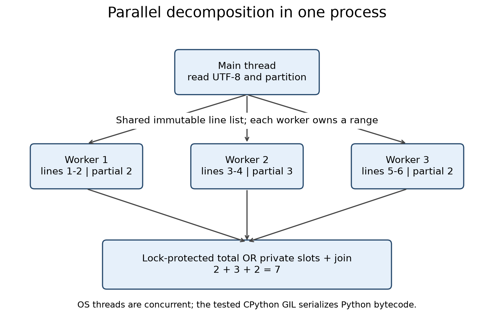
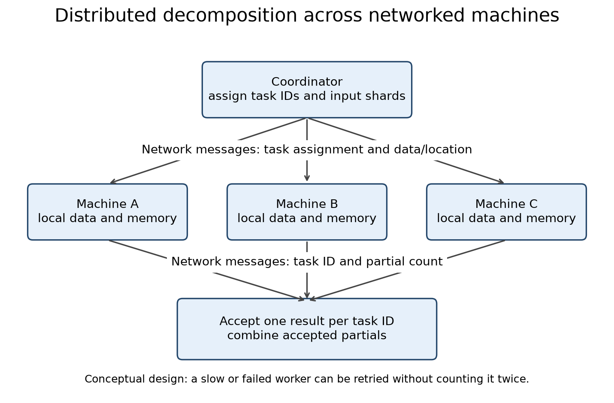
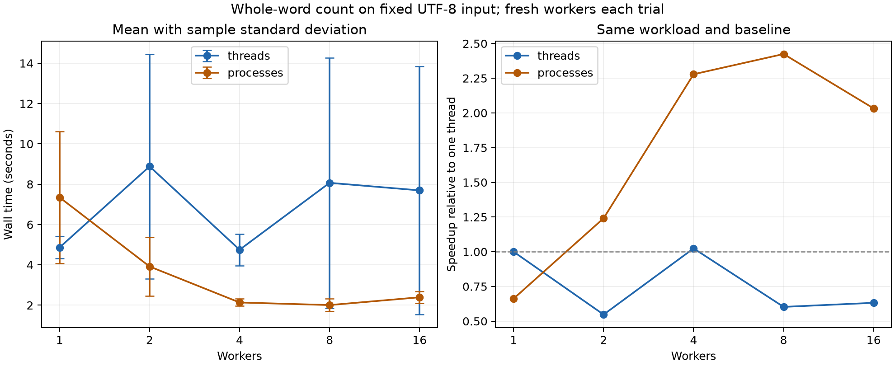

# Exploring Parallel and Distributed Computing

COSC 451 Operating Systems — Rafik Hariri University  
Research and implementation report — 8 November 2026

## 1 Purpose and scope

We investigate how a problem can be divided among cooperating workers, and what the operating system must provide for that cooperation. Our practical example counts one word in a text file using Python threads. The important questions are whether the decomposition preserves the answer, how workers combine partial counts, and whether extra workers reduce elapsed time. We also implement a separate-process comparison. We do not implement a networked distributed service.

Correctness and performance require different evidence. A count can be correct even when extra threads make it slower. We therefore use a small file that can be checked by hand, automated boundary and synchronization tests, and repeated measurements on a fixed large file. Our standard CPython build has the Global Interpreter Lock enabled. The threaded program demonstrates shared-memory concurrency and parallel decomposition, while the process comparison can execute Python instructions on multiple cores. We distinguish that architectural possibility from the speedup actually observed.

## 2 Parallel and distributed computing

Parallel computing uses multiple computational resources at the same time to work on a problem. Distributed computing places cooperating components in separate networked machines, each with its own memory and execution environment. These descriptions overlap: parallel describes concurrent execution of useful work, while distributed describes where components live and how they communicate. A cluster can use message passing between nodes and threads within every node. Conversely, multiple concurrent threads on one CPU do not establish simultaneous execution. LLNL's tutorial distinguishes shared-memory, distributed-memory, and hybrid arrangements [1].

| Question                            | Our shared-memory parallel design        | A distributed design                       |
| ----------------------------------- | ---------------------------------------- | ------------------------------------------ |
| Where are workers?                  | OS threads inside one process            | Processes on different computers           |
| What can they access directly?      | The same line list and result structures | Their local memory and storage             |
| How does work move?                 | Main supplies index ranges               | Coordinator sends tasks or shard locations |
| How do results move?                | Shared counter or separate result slots  | Messages containing task IDs and results   |
| What is the main coordination risk? | Concurrent updates or unbalanced work    | Delayed messages and partial failure       |
| Can both be combined?               | Yes, within each distributed worker      | Yes, by using local parallel workers       |

These columns describe the two designs we compare, not universal restrictions. Parallel computing does not require shared memory, and distributed systems are not defined simply by having more than one process. Our local process pool uses IPC on one laptop; it is not evidence of network distribution.

A real parallel example is GPU rendering in Blender Cycles. Blender supports rendering on GPUs and configurations with multiple GPUs [2]. Rendering contains substantial repeated work over scene samples; distributing that computation across GPU execution resources is parallel computation. At the application level the partial contributions must eventually produce a coherent image. This example fits because compute resources cooperate on the same rendering job. We have not benchmarked Blender, so we do not assign it a speedup or claim our Python loop behaves like its native rendering kernels.

A real distributed example is Google's MapReduce implementation described by Dean and Ghemawat in 2004. It processed data such as crawled documents and web request logs across a cluster. Map tasks produce intermediate key/value pairs; reduce tasks combine values associated with each key. The runtime assigns work, transfers intermediate data, and manages failures [3]. It is distributed because the participating machines have separate resources and communicate, and it is also parallel when tasks execute concurrently. This is a documented historical example, not a claim about Google's current production architecture.

## 3 Dividing work and combining results

### 3.1 Our parallel decomposition

Main reads the file once into a list of complete lines. For L lines and N workers, worker i owns the half-open interval `[floor(iL/N), floor((i+1)L/N))`, where i starts at zero. Its start is included and its stop is excluded. The next worker starts exactly at that stop, the first starts at zero, and the last stops at L. This proves that every line belongs to exactly one interval. Empty intervals remain valid when N exceeds L.



The equivalent text diagram is:

```text
                    MAIN: read six complete lines
                  shared immutable list in one process
                       /           |           \
                worker 1       worker 2       worker 3
                lines 1-2      lines 3-4      lines 5-6
                partial 2      partial 3      partial 2
                       \           |           /
                       lock-protected shared total
                       OR separate slots then join
                              2 + 3 + 2 = 7
```

Workers exchange no text with one another. They read their assigned lines, keep local counts, and publish integers. In the lock version, each worker adds its partial count to one shared total while holding `threading.Lock`. In the slots version, each worker owns one output slot and main sums only after all joins. The second design removes the application-level combine lock; it is not a claim of lock-free progress in the formal concurrency sense.

Partitioning by line protects token boundaries without calculating byte offsets. Newlines are separators under our token definition, so a token cannot extend across a chunk boundary. A UTF-8 character is decoded before partitioning and cannot be cut in half. This simplicity has a cost: equal line counts do not imply equal character counts. A single enormous line remains assigned to one worker. We accept this limitation because it keeps the demonstration easy to inspect, and our generated experiment uses equal-length lines.

### 3.2 A conceptual distributed decomposition

For a distributed version of our count, a coordinator could assign each machine a shard and a unique task ID. Each machine would count locally, then send the task ID and partial count back. The coordinator would track which tasks are complete and sum one accepted result per task. This is our proposed design for explanation, not an additional executed implementation.



```text
                       COORDINATOR
                task IDs and input shard locations
                   /          |          \
              network      network      network
              machine A    machine B    machine C
              local data   local data   local data
                   \          |          /
                  messages: task ID + partial result
                accept each task once, then combine
```

Data might be sent with each task or already stored near the worker. Moving only locations and integer results can reduce communication, but it requires workers to access the correct input version. Our local threads need no equivalent network protocol because the line list is already in the same address space. A hybrid extension could use the diagram's machines as outer workers and the first diagram's decomposition inside each machine.

## 4 Operating system concepts and challenges

### 4.1 Threads, shared memory, and scheduling

A thread has its own execution state while sharing its process's address space. Context switching saves one execution state and resumes another. Multiple ready threads may be scheduled on different cores or take turns on the same core [4]. In our implementation, `lines` is shared but not mutated, and local token positions belong to each worker's function call. That distinction explains why scanning can be independent while combining results needs coordination.

Starting N threads does not promise N-way CPU execution. The OS scheduler chooses when threads run, and the Python interpreter adds another restriction: the enabled GIL allows only one thread to execute Python bytecode at a time in this process [5]. The OS still sees real threads, which may wait, resume, or perform operations outside Python bytecode. Our workload is dominated by a Python character loop and performs no file reads inside workers. We therefore expect little opportunity to overlap useful work while one thread waits for I/O.

Trace intervals are wall-time intervals, not measurements of CPU occupancy. Overlapping intervals would show concurrent lifetimes but would not prove simultaneous Python execution. Our tiny trace actually shows successive worker intervals. We did not collect CPU utilization, affinity, or context-switch counters, so explanations about scheduling overhead are mechanisms consistent with the design rather than directly measured counter values.

### 4.2 Synchronization and a concrete race

A shared read/modify/write operation can lose an update if another worker acts between its read and write. A mutex protects a critical section so that competing workers cannot enter it together [6]. For example, if the total is zero and two workers independently read zero, both can write one. Two attempted increments then leave a total of one. The arithmetic is correct in isolation; the interleaving breaks the intended combined operation.

Our normal counter performs the expensive scan locally and locks only once per worker. Locking every match would increase critical-section traffic unnecessarily. The slot version avoids competing writes to the same element: worker i writes slot i, and main waits for all writers before reading the combined result. Joining is essential; summing early could include the initial zero from an unfinished worker. We also propagate worker exceptions to the caller so a failed worker cannot silently leave a plausible but incomplete answer.

We ran a deliberately controlled race with four workers attempting 100 increments each. The expected count was 400; the unsafe result was 100, losing 300 updates; the locked result was 400. The unsafe code uses a barrier after reading so all workers read the same value, a forced yield, and a second barrier after writing. Thus each round preserves only one of four increments. The safe version locks the read/yield/write operation and does not wait at a barrier while holding the lock.

This is evidence that the specified interleaving causes lost updates, not an estimate of spontaneous race frequency. We do not claim that an ordinary `counter += 1` loop must fail on this CPython version. The artificial barriers make the teaching example repeatable and clearly separate it from the correct counting implementation.

A second practical parallel challenge is load imbalance. Suppose one of our six lines contains almost all the characters. The worker owning it must finish before main can return, even if the others have finished. More workers would not divide that line. A future implementation could find safe token boundaries near byte targets or schedule many smaller tasks, but it would require more boundary and coordination logic. This is a design analysis, not a second benchmark.

### 4.3 IPC, network communication, and partial failure

Separate processes cannot use an ordinary Python list as a common mutable address space. Our process pool serializes each chunk into a worker process and returns an integer through its IPC mechanisms. Each process has its own interpreter, avoiding the single interpreter's GIL [7], [8]. We explicitly use the spawn start method, including on platforms where another default exists, and create a fresh pool for every trial. Input serialization and startup are consequently part of the measured cost.

Across machines, communication adds delay and the possibility that one component stops responding while others continue. A timeout cannot by itself distinguish a failed worker from a slow network. Distributed-system design therefore needs explicit failure handling [9]. In our proposed distributed counter, suppose a worker completes task 12 but its reply is delayed. A coordinator might retry task 12 elsewhere. Adding both replies would double-count the shard. Accepting one result for each task ID prevents that particular error, while timeout and retry still increase completion time. Recovering from coordinator failure would require additional durable state beyond this simple proposal.

MapReduce provides a concrete documented recovery mechanism: its master reassigns unfinished work from failed workers, and completed map tasks may need recomputation because their intermediate files were on the failed machine [3]. We do not equate that full system with our simple conceptual diagram. The broader lesson is that distributing work introduces both a performance cost for communication and correctness responsibilities for incomplete or repeated work.

## 5 Implementation and correctness

The source is an original implementation written for this project. It uses `uv` for environment management and execution, with CPython 3.13.15 pinned and dependencies locked. The application scanner uses only the Python standard library. Matplotlib creates the figures and pytest verifies the behavior. The package exposes separate commands for counting, generating input, running the race, and measuring performance, keeping the live commands short.

We define a word as a maximal sequence of Unicode alphanumeric characters or underscores. A match compares the complete token with the target. Thus `the,` matches and `other` does not; `the_the` is one different token. Punctuation separates tokens, including hyphens and apostrophes. Case-insensitive mode applies `casefold()` [10]. We do not apply Unicode normalization: canonically equivalent spellings containing combining marks are outside the intended language-independent token definition. Invalid UTF-8 and invalid targets are explicit errors.

The scanner remembers a token's starting index while walking each character. At a separator it slices the completed token and compares it. It also checks an unfinished token at the end of each line, handling files without a final newline. Using indices avoids repeatedly concatenating an ever-growing token. It does not use `str.count`, which would need additional boundary logic, or regex in the measured path. Although built-in character and string operations have native implementations, the per-character control flow remains Python code. A different native scanner could change both overhead and threading behavior; we make no general claim that C implementation alone implies GIL release.

Our six-line sample has lowercase counts 2, 0, 2, 1, 1, 1, totaling **7**. Case-insensitive matching adds `The` on line 2 and `THE` on line 3, totaling **9**. With three threads, the assigned line pairs produce **2, 3, 2**. The actual lock trace is reproduced in the README and preserved in `results/trace.txt`; its worker start times were 0.731, 1.052, and 1.194 milliseconds from dispatch. Both safe combine methods returned seven.

We executed `uv run pytest -q`: **29 tests passed in 2.94 seconds** in the saved run. Coverage includes single and multiple threads, both reductions, complete words at line boundaries, empty input, case sensitivity, substring exclusions, Unicode case folding, CRLF, a missing final newline, long tokens, more workers than lines, invalid arguments, process agreement, controlled races, and worker-error propagation. A seeded generated text is also checked against an independent regex tokenization oracle. These tests support the specified semantics; they do not establish every possible linguistic definition of a word.

## 6 Experiment design and prediction

Before running the experiment, we recorded the prediction in `docs/prediction.md`. We expected little or no threading speedup because the character loop executes Python bytecode. We expected processes to offer a possible advantage, but warned that fresh process startup and text serialization could erase it. The experiment changes worker count while keeping file, target word, case mode, scanner, and main-thread reduction method fixed. The process series is a separately labelled implementation comparison rather than a hidden change to the main thread experiment.

The generator repeats a manually checkable 57-byte line containing three exact lowercase matches. It writes **919,804 lines**, producing **52,428,828 bytes**, slightly more than 50 MiB because it preserves complete lines. The expected total is therefore **919,804 × 3 = 2,759,412**. A SHA-256 digest detects changes to the generated input. The generator's count follows from the line construction, independently of the counting algorithm.

The benchmark machine was an **Intel Core i7-1185G7 at a reported 3.00 GHz**, with **4 physical cores and 8 logical processors**, running **Windows 11, build 10.0.26300**. The interpreter was **64-bit CPython 3.13.15 with the GIL enabled**. Hardware data came from Windows `Win32_Processor`; full interpreter and OS strings are saved in `results/metadata.json`. We tested **1, 2, 4, 8, and 16 workers**, covering twice the physical-core count and extending to twice the logical-processor count.

Each configuration received one warm-up and three measured repetitions. We shuffled the ten backend/count combinations within each measured repetition using seed 451. Each trial created fresh workers and checked its total against the generator's answer. The input was read and decoded once before timing. The timer includes partitioning, worker creation, process serialization where applicable, scanning, reduction, joins, and shutdown. Trace printing, file generation, plotting, and initial input loading are excluded. Consequently these results describe a preloaded counting job, not complete command startup or cold disk throughput.

We use an outer `perf_counter()` wall-clock interval [11]. The table reports arithmetic mean, sample standard deviation, minimum, and maximum. Speedup is `mean time with one thread / mean time for the configuration`, so both backends share a common reference. A speedup below one means slower than that baseline. Three trials provide a small descriptive sample; standard deviation is not a confidence interval or proof of statistical significance. We did not control background system activity, thermal state, CPU frequency, or power mode.

## 7 Measured results and interpretation

All 30 measured trials and all 10 warm-ups returned **2,759,412**, matching the generator's prediction. Initial read/decode took **0.2140 seconds**, excluded from the table. Measurements were captured on 8 November 2026. Values below are rounded from `results/summary.csv`; individual timings remain in `results/raw.csv`.

| Backend   | Workers | Mean s |   SD s |  Min s |   Max s | Speedup vs 1 thread |
| --------- | ------: | -----: | -----: | -----: | ------: | ------------------: |
| threads   |       1 | 4.8630 | 0.5495 | 4.3692 |  5.4550 |               1.000 |
| threads   |       2 | 8.8832 | 5.5744 | 5.1813 | 15.2944 |               0.547 |
| threads   |       4 | 4.7495 | 0.7811 | 4.1573 |  5.6347 |               1.024 |
| threads   |       8 | 8.0686 | 6.2079 | 4.2143 | 15.2300 |               0.603 |
| threads   |      16 | 7.6941 | 6.1592 | 4.1144 | 14.8061 |               0.632 |
| processes |       1 | 7.3460 | 3.2712 | 5.1284 | 11.1029 |               0.662 |
| processes |       2 | 3.9184 | 1.4587 | 2.9523 |  5.5964 |               1.241 |
| processes |       4 | 2.1342 | 0.1792 | 1.9548 |  2.3133 |               2.279 |
| processes |       8 | 2.0059 | 0.3165 | 1.6690 |  2.2970 |               2.424 |
| processes |      16 | 2.3924 | 0.2987 | 2.1155 |  2.7089 |               2.033 |



The threading results support our prediction of no useful scaling. Four threads have a nominal speedup of 1.024, but their spread is much larger than the approximately 0.11-second difference in means. We cannot interpret this as a demonstrated parallel CPU benefit. The other multithreaded configurations have slower means. This is compatible with the enabled GIL and extra worker-management costs, but we cannot attribute every timing difference to either mechanism from wall time alone.

Variation is substantial and systematic over parts of the run. For example, eight threads took 15.2300, 4.7616, and 4.2143 seconds across the three repetitions. Earlier warm-ups also varied sharply. Shuffling configuration order reduces a fixed ordering bias but does not eliminate changing machine conditions. We retained these measurements and display their standard deviations rather than discard the slow trials. They limit the precision of any comparison, especially small differences near a speedup of one.

The process series differs: four and eight processes averaged 2.1342 and 2.0059 seconds, respectively, despite including fresh-pool startup and serialization. Eight processes had the lowest observed mean and a **2.424×** speedup against one thread. Sixteen processes were slower than eight. This is consistent with processes using multiple cores and eventually encountering overhead or resource limits. It does not prove that eight is always optimal: the four- and eight-process timing ranges overlap, and we measured neither per-core utilization nor memory bandwidth. Logical processors also share physical-core resources, so eight logical processors do not imply eight independent full cores.

One process was slower than one thread in the saved measurements. A child interpreter and transferred input add costs without adding another simultaneous counting worker. More processes can amortize that overhead on this input, but the same benefit is not guaranteed for a tiny file. The comparison measures our straightforward transfer-and-spawn design; a persistent pool or shared-memory input would be a different experiment.

The benchmark uses a regular generated input and three repetitions on one laptop. It does not establish performance for irregular text, much larger files, cold storage, or another runtime. We ran the standard GIL-enabled build only; no free-threaded speedup is claimed. A future experiment could measure a free-threaded interpreter, but its results would need separate execution and correctness checks. These limits preserve the distinction between what our code demonstrates, what our timings show, and what remains an explanation or prediction.

## 8 Conclusion

Our demonstration makes work ownership and result combination visible. Whole-line partitioning preserves tokens, independent local counts simplify reasoning, and both safe reductions agree with a hand count. The controlled race shows exactly how an unprotected read/modify/write can discard updates. The benchmark then asks a different question: whether the chosen execution mechanism helps this workload. We retain the observed results rather than assuming that a larger worker count must be faster.

The distributed comparison adds a further lesson: moving workers to other machines changes how data and failures must be handled. Local shared-memory ownership is replaced by messages, task identities, and recovery rules. A system can combine both forms, but its speed and reliability depend on those mechanisms as well as the number of compute resources.

## References

IEEE-style numbered citations are used throughout. Online documentation and chapters were accessed on 8 November 2026; `n.d.` means no publication year is asserted for the living page.

[1] Lawrence Livermore National Laboratory, “Introduction to Parallel Computing Tutorial,” *HPC at LLNL*, n.d. [Online]. Available: https://hpc.llnl.gov/documentation/tutorials/introduction-parallel-computing-tutorial

[2] Blender Foundation, “GPU Rendering,” *Blender 4.3 Manual*, version 4.3, n.d. [Online]. Available: https://docs.blender.org/manual/en/4.3/render/cycles/gpu_rendering.html

[3] J. Dean and S. Ghemawat, “MapReduce: Simplified Data Processing on Large Clusters,” in *Proceedings of the 6th Symposium on Operating Systems Design and Implementation (OSDI '04)*, USENIX, 2004, pp. 137–150. [Online]. Available: https://research.google/pubs/mapreduce-simplified-data-processing-on-large-clusters/ ; author manuscript: https://research.google.com/archive/mapreduce-osdi04.pdf

[4] R. H. Arpaci-Dusseau and A. C. Arpaci-Dusseau, “Concurrency: An Introduction,” ch. 26, *Operating Systems: Three Easy Pieces*, online version 1.10, Arpaci-Dusseau Books, n.d. [Online]. Available: https://pages.cs.wisc.edu/~remzi/OSTEP/threads-intro.pdf

[5] Python Software Foundation, “threading — Thread-based parallelism,” *Python 3.13 Documentation*, n.d. [Online]. Available: https://docs.python.org/3.13/library/threading.html

[6] R. H. Arpaci-Dusseau and A. C. Arpaci-Dusseau, “Locks,” ch. 28, *Operating Systems: Three Easy Pieces*, online version 1.10, Arpaci-Dusseau Books, n.d. [Online]. Available: https://pages.cs.wisc.edu/~remzi/OSTEP/threads-locks.pdf

[7] Python Software Foundation, “multiprocessing — Process-based parallelism,” *Python 3.13 Documentation*, n.d. [Online]. Available: https://docs.python.org/3.13/library/multiprocessing.html

[8] Python Software Foundation, “concurrent.futures — Launching parallel tasks,” *Python 3.13 Documentation*, n.d. [Online]. Available: https://docs.python.org/3.13/library/concurrent.futures.html

[9] R. H. Arpaci-Dusseau and A. C. Arpaci-Dusseau, “Distributed Systems,” ch. 48, *Operating Systems: Three Easy Pieces*, online version 1.10, Arpaci-Dusseau Books, n.d. [Online]. Available: https://pages.cs.wisc.edu/~remzi/OSTEP/dist-intro.pdf

[10] Python Software Foundation, “Built-in Types,” *Python 3.13 Documentation*, sections on `str.isalnum` and `str.casefold`, n.d. [Online]. Available: https://docs.python.org/3.13/library/stdtypes.html

[11] Python Software Foundation, “time — Time access and conversions,” *Python 3.12 Documentation*, section on `time.perf_counter`, n.d. [Online]. Available: https://docs.python.org/3.12/library/time.html
